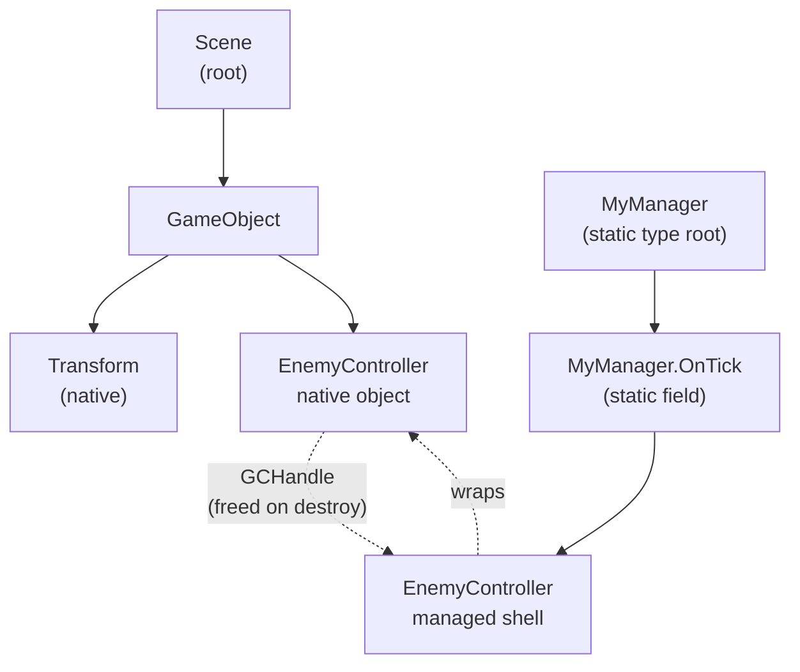
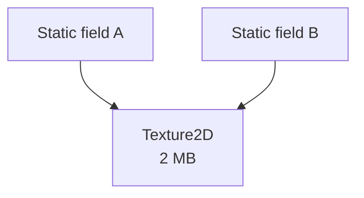
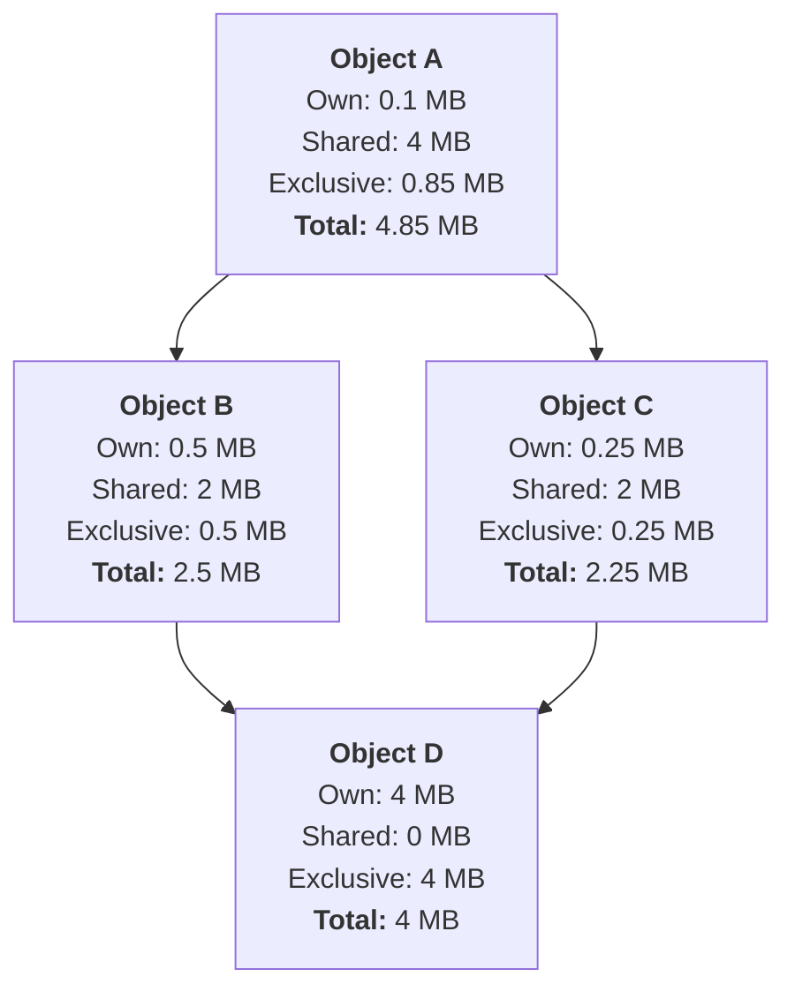
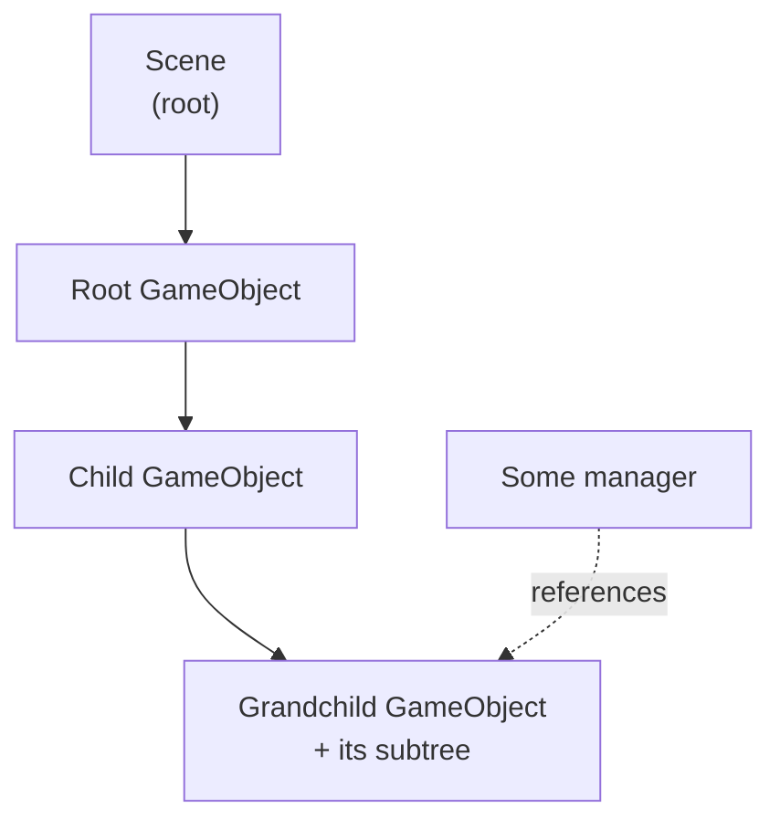

# Root ownership and impact attribution

Understand how the Memory Profiler determines what keeps each object in memory and how it attributes shared memory to the roots responsible for it.

When you open a snapshot, the Memory Profiler analyzes the reference graph of every native and managed object to identify the root that stops it from being released from memory, and how much memory it's responsible for. The [Roots & Impact view](roots-and-impact.md) presents the result. This page explains how roots are identified.

## Roots and the shortest path to root

A root is something that keeps memory alive, for example: a managed static field, a loaded scene, an AssetBundle, a `GCHandle`, or a native subsystem.

Every object that survives is accessible from at least one root. The Memory Profiler finds each object's shortest path to root and assigns each object to that root. The Memory Profiler prioritizes roots by expected lifetime, which means that each object is attributed to the longest-lived root that reaches it.

A Unity Object that has both a native object and a managed shell can have two different paths to root, because the two parts can be kept alive by different things. In the following example, a `MonoBehaviour` lives in a scene, but a managed static event also references its managed shell:

Native objects are released when the scene unloads. While the native object is alive, it also holds its managed shell through a `GCHandle`, so the garbage collector can't collect the shell. That `GCHandle` is freed when the native object is destroyed, so it doesn't keep the shell alive. The managed shell is also rooted to the static event, so it survives until the static reference is cleared. If the scene unloads but the static event still references the shell, the native side is destroyed while the managed shell remains: a leaked managed shell. For more about this, refer to [Analyzing Unity object memory leaks](managed-shell-objects.md).

Scene objects are a common version of this split: the native side is rooted through its Transform hierarchy, while the managed shell is rooted separately. To learn how that shapes their impact, refer to [Scene hierarchy impact attribution](#scene-hierarchy-impact-attribution).

## Root priority order

The Memory Profiler processes roots in a fixed order, from the longest-lived to the shortest-lived. Longest-lived roots have a stronger association with rooted objects. Each object is attributed to the first root that reaches it. This order decides the root location of an object that can be reached from several roots.

Select a group header to display a description of what it contains in the [Selection Details panel](selection-details-component.md).

The roots are stored in root buckets, in the following priority order:

| Root bucket | Description |
| --- | --- |
| Frozen / Non-GC Heap | Managed objects with no root at all, such as interned strings or frozen `RuntimeType` instances living on a frozen / Non-GC heap segment, or an object briefly pinned for a native call with no tracked handle. They're exempt from normal garbage collection because of where they live, not because something references them, which makes them the longest-lived bucket. |
| Static Roots | Memory reached from managed static fields. Statics live for the lifetime of the loaded domain and are only released when your code clears the reference, which makes them the strongest roots and a common source of leaks. Entries are grouped by namespace and type. |
| Don't Destroy on Load | Assets marked `DontDestroyOnLoad` (via `Object.DontDestroyOnLoad()` or their `HideFlags`). They survive scene unloads and the asset garbage collection (`Resources.UnloadUnusedAssets()`) and are only released when something destroys them explicitly. GameObjects and Components marked `DontDestroyOnLoad` are moved into the dedicated scene instead, so they don't appear here. |
| Don't Destroy on Load (Deletion Queue) | `DontDestroyOnLoad` objects already queued for delayed destruction; usually rare and timing-dependent to catch in a snapshot. |
| Don't Destroy on Load Scene | The dedicated `DontDestroyOnLoad` scene and the GameObjects and Components moved into it via `Object.DontDestroyOnLoad()`. Like a regular scene it roots its hierarchy, but unlike a regular scene it is never unloaded, so its contents persist for the whole session unless destroyed explicitly. |
| Scenes | Regular loaded scenes and the hierarchies they root; released when the scene unloads. |
| Asset Bundles | Assets kept loaded only because their `AssetBundle` is loaded. |
| Native Object Roots | Native Unity objects that act as roots in their own right: native subsystem managers, unused or leaked assets awaiting the next asset garbage collection, or objects a subsystem holds directly rather than through a managed reference, scene, or bundle. |
| Unreferenced Prefabs | Prefab assets nothing references, which the next asset garbage collection will unload. |
| GC Handle Roots | Managed objects pinned by a `GCHandle` that isn't tied to a Unity object, such as handles from native plugins, interop, or managed code. |
| Stack Roots | Managed objects kept alive by a local variable or method argument on a thread's stack. They stay rooted for as long as that stack frame is active. |
| Finalizer Roots | Managed objects kept alive by an entry in the finalizer queue, until their Finalize/destructor method has run. |
| Other Roots | Managed objects kept alive by a backend-reported managed root of an unattributed kind, such as a static field without per-field attribution. |
| Native Root Allocations | Native allocations a subsystem registers as roots directly, rather than through a Unity object. |
| Broken Script References | Native `MonoBehaviour` or `ScriptableObject` instances whose backing script is missing, so nothing references them and no root keeps them alive; each one is effectively a leak. |

Stack Roots, Finalizer Roots, Other Roots, and Frozen / Non-GC Heap are only present in snapshots captured with the CoreCLR scripting backend, and are grouped together under a "Managed Roots" header in the table.

The following buckets that have no root are listed after the rooted buckets so the table still reconciles with the snapshot total:

| Bucket | Description |
| --- | --- |
| Virtual Machine Memory | The scripting runtime's own native overhead. |
| Unrooted Native Subsystem Allocations | Native allocations the profiler can't attribute to any owner. |

## Exclusive and shared impact

An object's impact is the memory that's attributed to it. It has two parts:

- Exclusive: Memory that only this object keeps alive. If the object goes away, this memory can be freed.
- Shared: Memory that's also kept alive through other reference paths. The Memory Profiler divides shared memory evenly among the objects responsible for it, so that no memory is counted twice in the table total.

In the following example diagram, two separate static roots both reference the same 2 MB texture:

Each root receives an equal value of 1 MB for the texture, and a **Shared (non-distributed)** value of 2 MB, which is the total memory it affects. The texture contributes 2 MB to its total impact in the table once, not twice. Neither root can free the texture on its own, which is exactly what a shared value of less than the full size tells you.

The memory split is byte-accurate. When memory is divided among several referees, each receives an equal whole-byte share, and any leftover bytes from the division are handed out one at a time to the referees that were found first. The fractions therefore always add back up to the original size exactly, so the view never loses or invents bytes to rounding.

## Equal memory sharing and hidden exclusive ownership

An object can be the single owner of some memory and register as **Shared**. This happens because the memory is split wherever an object has more than one referee, it is marked as **Shared** and that classification stays with each part of the split memory.

In the following example diagram, object A reaches object D through its children B and C, which each have their own size:

Objects B and C can both reach object D, which means its 4 MB is split evenly: 2 MB attributed through B and 2 MB through C. This stays classified as **Shared** as it rolls up. B and C are each reached only by A, so their own memory belongs to A alone: B's 0.5 MB and C's 0.25 MB roll up into A's **Exclusive**.

In the diagram, **Own** is each object's own memory before its children's exclusive contributions roll up into it. The Own value is only different from the **Exclusive** value when an object has children of its own, as A does here.

Object A ends up with about 0.85 MB exclusive memory (its own 0.1 MB, plus B's 0.5 MB and C's 0.25 MB) and 4 MB **Shared** (D, through both paths), for a total of about 4.85 MB. Object A is the only thing keeping D alive, so in principle that 4 MB is exclusive to A, but it stays in the **Shared** column because the split happened lower down at D and the view has no information to recognize that A reunites both paths. The **Shared (non-distributed)** column still shows the full 4 MB, which is why it's useful for spotting objects that are responsible for more memory than their equally shared value suggests.

## Scene hierarchy impact attribution

> [!NOTE]
> This section covers the native side of scene objects. A Unity Object's managed shell is rooted separately. For more information, refer to [Roots and the shortest path to root](#roots-and-the-shortest-path-to-root).

Scene objects follow the Transform ownership hierarchy, with its GameObjects and their components. Each object's impact rolls up to its parent in that hierarchy, level by level, all the way to the scene or prefab that owns it.

Other objects often hold references that point into the middle of a scene hierarchy. For example, a manager might reference a grandchild GameObject directly, or a component on one branch might reference a component on another:

Reference that point to the middle of a hierarchy don't change who owns the native part of a scene object. A scene object is always owned through its hierarchy, not through an incidental reference from elsewhere. The Memory Profiler therefore ignores these references when attributing impact, so the grandchild's memory rolls up through its own hierarchy (Grandchild → Child → Root GameObject → Scene) instead of being pulled toward the referencing object or split across branches. Each scene object's impact stays on the branch that owns it, and the table total reconciles against the snapshot.

## Additional resources

- [Attribute memory to its roots](roots-and-impact.md)
- [Analyzing Unity object memory leaks](managed-shell-objects.md)
- [References panel reference](references-component.md)
- [Selection Details panel reference](selection-details-component.md)
