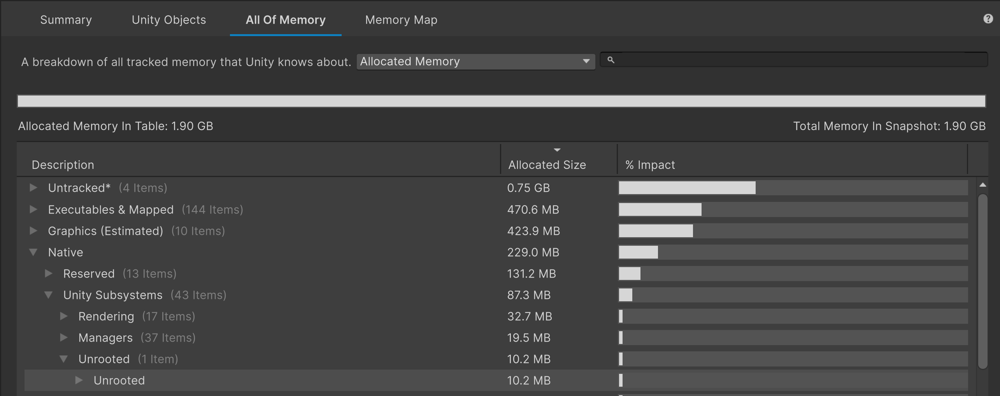

# Unrooted native memory introduction

Unity attributes all native memory allocations to either a Unity subsystem or a `UnityEngine` object. The memory-owning subsystem or object is referred to as a root, and the root's information is propagated down to every related allocation.

Sometimes Unity can't assign the root owner correctly, doesn't assign one at all, or deletes it without the transfer of ownership to a new root. In this case, memory shows as unrooted.

> [!NOTE] In versions before Memory Profiler 1.1.9, Unity Engine categorized these allocations as unknown memory.

## Locate unrooted memory in the snapshot

> [!IMPORTANT] Unrooted memory isn't untracked memory. Refer to [Memory usage on devices](memory-on-device.md) for more information on untracked memory.

To locate unrooted memory in your snapshot, navigate to **All Of Memory table** > **Native** > **Unity Subsystems** > **Unrooted** > **Unrooted**.

By default, Memory Profiler doesn't capture call stacks of unrooted allocations. To investigate unrooted memory in detail, you can add call stack information to snapshots in both the Unity Editor and Player. For more information, refer to [Capture a snapshot with call stacks](unrooted-capture.md).

## Why use call stacks

A call stack is a record of the chain of function calls that led to a specific point in a program's execution.

Use call stacks to do the following:

- Trace native allocations.
- Spot missing cleanup.
- Spot possible leaks.

## When to contact Unity support

Unity support has access to additional internal tools to review memory call stacks and to help them redirect support requests to the relevant teams. If you notice especially large usage or growth under certain memory labels, submit an issue report to Unity support in the Unity Editor through **Help** > **Report a Problem**. For quicker resolution and help, include the following information in your report:

- A copy of the project in which you want to review the memory call stacks.
- A description of the project.

## Additional resources

- [Snapshots](snapshots.md)
- [Inspect memory usage](inspect-memory-usage.md)
- [Memory usage on devices](memory-on-device.md)
